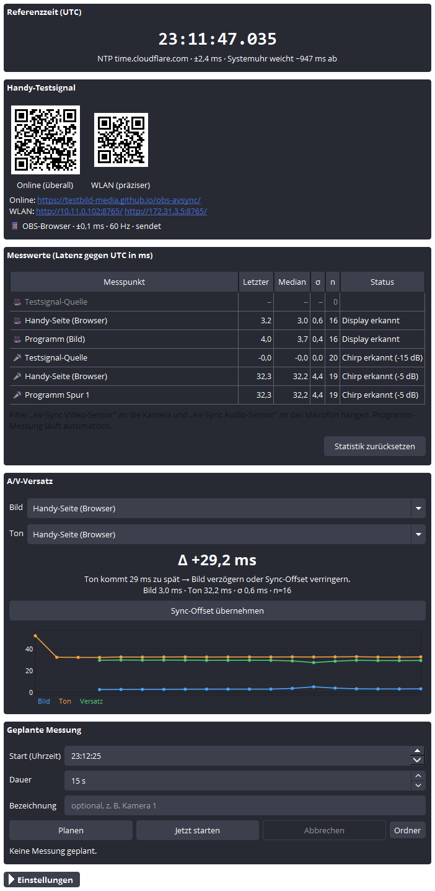

# AV-Sync – Latenzmessung für OBS Studio

Misst in OBS die **Video-Latenz** und die **Audio-Latenz** einzeln gegen **echte UTC-Zeit**
und daraus den **A/V-Versatz**, ähnlich wie Hitomi MatchBox Glass. Dazu gehören zwei Teile:

| Teil | Was es tut |
|---|---|
| **Handy-Seite** (`web/`, reines HTML/JS/CSS) | Zeigt eine Echtzeituhr und sendet zu **jeder vollen UTC-Sekunde** einen Lichtblitz und einen Ton-Chirp. Online unter **https://testbild-media.github.io/obs-avsync/** oder direkt vom Plugin im WLAN. |
| **OBS-Plugin** (`obs-avsync.dll`) | Erkennt Blitz und Chirp in Kamera, Mikrofon und Programmausgang, vergleicht mit seiner NTP-Uhr und zeigt alles im Dock **„AV-Sync“**. |



---

## So funktioniert die Messung

```
Handy (UTC per Internet-Zeit oder WLAN)        OBS (UTC per NTP)
  ── Blitz, Mitte genau bei k·1000 ms ──► Kamera ──► Video-Sensor ──┐
  ── Chirp, Start genau bei k·1000 ms ──► Mikro  ──► Audio-Sensor ──┼─► Latenz = Erkennung − k·1000 ms
                                                     Programm      ──┘   A/V-Versatz = Audio − Video
```

* **Gemeinsame Zeit:** Beide Seiten kennen die echte UTC-Zeit.
  * Die Handy-Seite gleicht ihre Uhr per HTTPS mit `time.akamai.com` ab (Ausweichquelle `timeapi.io`), typisch ±2–5 ms.
  * Wird die Seite direkt vom Plugin geladen (`http://<PC-IP>:8765/`), gleicht sie sich per WebSocket mit der OBS-Uhr ab, typisch < ±1 ms.
  * Das Plugin synchronisiert sich per NTP (Cloudflare, Google, pool.ntp.org) und korrigiert damit auch eine falsch gehende Windows-Uhr. Beim Test lag sie hier 0,77 s daneben.
* **Signal:** Ereignis *k* liegt bei UTC = *k* · 1000 ms.
  * Bild: weicher Hann-Lichtpuls von 200 ms, dessen Mitte genau auf der Sekunde liegt.
  * Ton: Chirp von 60 ms (800 → 4000 Hz), der genau auf der Sekunde beginnt.
  * Jede 10. Sekunde kommt ein **Marker** (Puls 500 ms, Ton abwärts). Damit werden auch Latenzen über 1 s eindeutig zugeordnet.
* **Video-Erkennung:**
  * Das Plugin findet das blinkende Display automatisch: Es prüft für jede Bildzelle, ob ihr Helligkeitsverlauf über eine Sekunde gefaltet wie ein Hann-Puls aussieht.
  * Der Messzeitpunkt ist der **Schwerpunkt** des Pulses. Dadurch ist die Messung genauer als ein Kamera-Frame und unabhängig von Bildrate, Belichtungszeit und Gamma.
* **Audio-Erkennung:** Matched Filter (normierte Kreuzkorrelation per FFT) mit Sub-Sample-Interpolation. Robust gegen Rauschen, Hall und Polaritätsumkehr.

## Installation

### OBS-Plugin (Windows, OBS 32.x, 64 Bit)

1. OBS schließen.
2. Release-ZIP entpacken und `install.cmd` ausführen.
   Alternativ den Ordner `obs-avsync` nach `C:\ProgramData\obs-studio\plugins\` kopieren.
   Aus dem Quellcode geht es mit `tools\install.ps1`.
3. OBS starten → Menü **Docks → AV-Sync**.
4. Fragt die Windows-Firewall nach OBS, „Private Netzwerke“ erlauben. Nur dann erreicht das Handy die WLAN-Seite.

Deinstallieren: Ordner `C:\ProgramData\obs-studio\plugins\obs-avsync` löschen bzw. `tools\install.ps1 -Uninstall` ausführen.

### Handy-Seite

* **Online:** **https://testbild-media.github.io/obs-avsync/**. Das Dock zeigt dafür standardmäßig einen QR-Code.
  * Die Seite liegt im Repository [testbild-media.github.io](https://github.com/testbild-media/testbild-media.github.io) im Ordner `obs-avsync/`. Nach Änderungen an `web/` aktualisiert `tools\publish-web.ps1` sie dort.
  * Über HTTPS verhindert die Seite auch, dass sich der Bildschirm abschaltet (Wake Lock).
  * Eigener Fork: `.github/workflows/pages.yml` veröffentlicht `web/` als Projektseite (manuell starten oder `push` einkommentieren). Die eigene URL dann im Dock unter *Einstellungen → Online-URL* eintragen.
  * Alternativ den Inhalt von `web/` auf einen beliebigen statischen Webserver legen.
* **Im WLAN direkt vom Plugin:**
  * Das Dock zeigt die Adresse (z. B. `http://192.168.1.20:8765/`) als QR-Code.
  * Das Handy muss im selben Netz sein. Das ist die genaueste Variante, funktioniert auch ohne Internet und zeigt die OBS-Messwerte auf dem Handy an.

Auf dem iPhone: Seite öffnen → *Teilen → Zum Home-Bildschirm* ergibt eine Vollbild-App.

## Messen in drei Schritten

1. In OBS an die **Kamera-Quelle** den Filter **„AV-Sync Video-Sensor“** hängen und an die **Mikrofon-Quelle** den Filter **„AV-Sync Audio-Sensor“**. Kamera mit eingebettetem Ton: beide Filter an dieselbe Quelle.
2. Auf dem Handy die Seite öffnen und **Starten** tippen.
   * Display möglichst groß und scharf in die Kamera halten, Lautsprecher Richtung Mikrofon.
   * Stummschalter aus, Lautstärke hoch, Auto-Sperre aus.
3. Im Dock **AV-Sync** erscheinen nach ~3 s die Latenzen.
   * Unter **A/V-Versatz** steht, ob der Ton zu früh oder zu spät kommt.
   * **Sync-Offset übernehmen** trägt die Korrektur direkt in die Audioquelle ein.

> Tipp: Für die Einrichtung im Video-Sensor **„Erkennungsbereich anzeigen“** aktivieren. Orange heißt „sucht“, grün „Display gefunden“, blau „Blitz erkannt“. Danach wieder abschalten, denn der Rahmen ist im Stream sichtbar.

## Das Dock

| Bereich | Inhalt |
|---|---|
| **Referenzzeit** | Lokalzeit der NTP-korrigierten Referenzuhr, NTP-Server, Genauigkeit, Abweichung der Windows-Uhr. |
| **Handy-Testsignal** | QR-Code und Links zur Handy-Seite (WLAN und online), verbundene Handys mit Sync-Genauigkeit und Bildrate. |
| **Messwerte** | Pro Messpunkt: letzter Wert, Median, Streuung σ, Anzahl, Status. Tooltip mit Mittelwert, Min, Max. |
| **A/V-Versatz** | Wahl von Bild- und Ton-Messpunkt, Versatz (Median), Interpretation, *Sync-Offset übernehmen*, Verlaufsgrafik. |
| **Geplante Messung** | Messlauf mit Startuhrzeit (oder *Jetzt starten*) und Dauer. Danach Zusammenfassung und automatische CSV-Datei (Standard: `Dokumente\AV-Sync`). |
| **Einstellungen** | Port, Online-URL, NTP-Server, Programm-Messung (Bild, Audiospur), maximale Latenz, Live-Fenster, CSV-Ordner und -Format. |

**Messpunkte**

* *Filter* messen eine einzelne Quelle (Kamera, Mikrofon, NDI, Capture-Karte …). Der Zeitpunkt entspricht dem Moment, in dem das Bild bzw. der Ton in OBS' Ausgabezeitleiste ankommt. Der Sync-Offset der Quelle ist berücksichtigt.
* *Programm (Bild)* und *Programm Spur N* messen das fertige Programm, also genau das, was in Stream und Aufnahme landet.

**Vorzeichen:** A/V-Versatz = Audio-Latenz − Video-Latenz.

* Negativ heißt: Ton kommt zu früh, also Ton verzögern.
* Positiv heißt: Ton kommt zu spät, also Bild verzögern oder den Sync-Offset verringern.

## Geplante Messung, CSV und HTTP-Steuerung

Die CSV-Datei enthält pro Sekunde die Latenz jedes Messpunkts sowie den A/V-Versatz, darunter Mittelwert, Median, Standardabweichung, Min, Max und Anzahl. Wahlweise ist sie für deutsches Excel formatiert (`;` und Dezimalkomma).

Der Plugin-Webserver nimmt einfache Befehle an, z. B. für die Stream-Deck-Aktion „Website“:

| URL | Wirkung |
|---|---|
| `http://127.0.0.1:8765/api/session/start?seconds=30&label=Kamera1` | Messlauf ab der nächsten vollen Sekunde |
| `…/api/session/start?seconds=60&at=20:00:00` | Messlauf um 20:00:00 Uhr |
| `…/api/session/cancel` | Messlauf abbrechen |
| `…/api/session` | Ergebnis des letzten Messlaufs (JSON) |
| `…/api/reset` | Statistik zurücksetzen |
| `…/api/status` | Alle Live-Werte (JSON) |

## Testsignal-Quelle

Die Quelle **„AV-Sync Testsignal“** erzeugt in OBS selbst exakt dasselbe Signal, inklusive 7-Segment-Uhr.

* **Selbsttest:** Testsignal-Quelle mit beiden Sensor-Filtern ergibt ~0 ms.
* **Strecken hinter OBS messen:** Programm streamen, z. B. auf einem zweiten PC mit OBS und Plugin empfangen, und dort die Latenz gegen UTC ablesen.

## Genauigkeit und Grenzen

Ergebnisse der automatischen Tests (portable OBS 32.2.2):

| Test | Ergebnis |
|---|---|
| Testsignal-Quelle → Video-Sensor / Programmbild | −0,13 ms, σ 0,03 ms |
| Testsignal-Quelle → Audio-Sensor / Programm-Audio | 0,00 ms / −0,01 ms |
| Handy-Seite als Browserquelle (Chromium in OBS) | Bild −19 ms, Ton +32 ms (σ ≈ 1 ms), Filter und Programm stimmen auf ~1 ms überein |
| Synthetisch: Kamera 15–60 fps, Belichtung 5–100 %, Gamma | Video-Schwerpunkt im Mittel ±1 ms |
| Synthetisch: Chirp mit Rauschen, Hall, 44,1/48 kHz | Audio ±0,002 ms |

* **Absolute Latenz** ist so genau wie beide Uhren: WLAN-Modus ±1 ms, Online-Modus ±2–5 ms, plus die feste Eigenverzögerung des Handys (siehe Kalibrierung).
* **Der A/V-Versatz hängt nicht von der Uhr ab.** Bild und Ton kommen vom selben Handy, Uhrfehler kürzen sich heraus.
* Video wird pro Kamera-Frame abgetastet. Der Schwerpunkt-Ansatz mittelt das heraus. Bei sehr kurzen Belichtungszeiten bleibt eine Restunsicherheit von bis zu einer halben Display-Bildwechselzeit des Handys (±4–8 ms), die über längere Messungen herausmittelt.
* **Rauschunterdrückung** (RNNoise, NVIDIA) entfernt den Chirp. Den Audio-Sensor deshalb oberhalb davon einsortieren oder die Unterdrückung zum Messen abschalten.
* **Erkenntnis aus den Tests:** Liefert eine Quelle ihren Ton „just in time“ (z. B. Browserquellen), verschiebt OBS deren Ton im Mix gelegentlich um einen ganzen Audio-Block (1024 Samples = 21,3 ms). Die Programm-Messung zeigt das. Die Filter-Messung sieht es nicht, weil es erst beim Mischen passiert.
* Latenzen über 1 s werden über die Marker aufgelöst, bis zur eingestellten *Max. Latenz*. Der Status „ohne Marker“ heißt: noch nicht durch einen Marker bestätigt.

## Kalibrierung des Handys (optional)

Browser und Handy haben eine kleine, feste Eigenverzögerung für Display und Lautsprecher. Die Seite schätzt sie automatisch: Display 2 Bildwechsel nach `requestAnimationFrame`, Audio über `AudioContext.getOutputTimestamp()`. Unter *Einstellungen & Kalibrierung* lässt sie sich feinjustieren.

1. **A/V-Gleichlauf des Handys:**
   * Das laufende Testsignal mit der Kamera-App eines **zweiten Handys** filmen. Handy-Videos sind A/V-synchron aufgenommen.
   * Die Aufnahme in OBS als Medienquelle mit beiden Sensor-Filtern abspielen. Die absoluten Latenzen sind dabei bedeutungslos (die Aufnahme ist ja älter). Der **A/V-Versatz** stimmt aber, notfalls ermittelt im Relativmodus.
   * Den angezeigten A/V-Versatz in Millisekunden als **Audio-Korrektur** auf der Handy-Seite eintragen (positiver Versatz → positiver Wert).
2. **Absolute Bildverzögerung:** Sie lässt sich ohne Referenz-Hardware nicht exakt bestimmen. Ohne Kalibrierung ist mit ±1 Display-Bildwechsel (±8–17 ms) zu rechnen.

## Aus dem Quellcode bauen

Voraussetzungen: Windows, Visual Studio 2019 oder 2022 (C++-Buildtools), CMake ≥ 3.24, Ninja, Git, installiertes OBS 32.x.

```powershell
powershell -ExecutionPolicy Bypass -File tools\setup-deps.ps1   # Header, Qt6-SDK, Import-Libs
powershell -ExecutionPolicy Bypass -File tools\build.ps1        # baut Plugin, Tests, Dev-Server
_build\avsync-tests.exe                                         # Unit-Tests
powershell -ExecutionPolicy Bypass -File tools\install.ps1      # ins installierte OBS kopieren
powershell -ExecutionPolicy Bypass -File tools\package.ps1      # Release-ZIPs in _build\release
powershell -ExecutionPolicy Bypass -File tools\publish-web.ps1  # Handy-Seite auf testbild-media.github.io aktualisieren
```

* Statt libobs selbst zu bauen, werden Import-Libraries aus der installierten `obs.dll` erzeugt (`tools\make-implibs.ps1`). Nach einem OBS-Update `tools\setup-deps.ps1` erneut ausführen.
* **End-to-End-Test** in einer isolierten, portablen OBS-Kopie (die eigene OBS-Konfiguration bleibt unberührt):

  ```powershell
  tools\e2e\setup-portable.ps1 -Target C:\Temp\obs-portable
  tools\e2e\run-e2e.ps1 -Target C:\Temp\obs-portable -Scene Testsignal -Seconds 40
  tools\e2e\run-e2e.ps1 -Target C:\Temp\obs-portable -Scene Browser -Seconds 60
  ```
* **Diagnose-Umgebungsvariablen** für OBS:

  | Variable | Wirkung |
  |---|---|
  | `AVSYNC_RECORD=<datei>` | Analysierte Frames aufzeichnen, offline auswerten mit `_build\avsync-replay.exe <datei>` |
  | `AVSYNC_DEBUG_DIR=<ordner>` | Analysebilder als PNG speichern |
  | `AVSYNC_SHOW_DOCK=1` | Dock beim Start öffnen |
  | `AVSYNC_DOCK_SNAPSHOT=<png>` | Screenshot des Docks alle 5 s |
* `_build\avsync-devserver.exe 8765` startet Handy-Seite und Uhr ohne OBS (Entwicklung der Webseite).

## Projektstruktur

```
web/                 Handy-Seite (index.html, app.js, style.css) – auch im Plugin eingebettet
src/                 OBS-unabhängiger Kern: Signaldefinition, FFT, Audio-/Video-Detektor,
                     Mess-Engine, NTP-Uhr, HTTP/WebSocket-Server
src/obs/             OBS-Teil: Plugin, Filter, Programm-Messung, Testsignal-Quelle, Qt-Dock
data/locale/         Deutsch / Englisch
tests/               Unit-Tests, Dev-Server, Replay-Werkzeug
tools/               Build-, Installations-, Paket- und E2E-Skripte
third_party/         qrcodegen (Nayuki, MIT)
```

## Lizenz

GPL-2.0-or-later, wie OBS Studio (siehe `LICENSE`). Enthält *QR Code generator library* von Project Nayuki (MIT-Lizenz, siehe `third_party/qrcodegen`).
